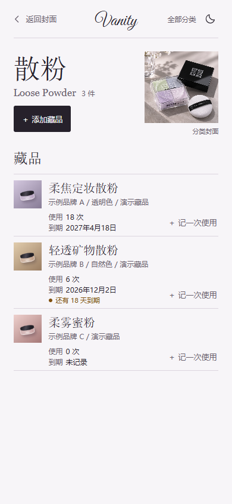
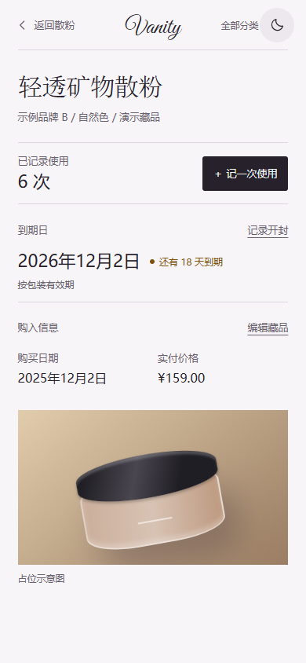

# Vanity · 我的美妆藏品

记录美妆藏品的使用次数、开封日期和到期时间。数据只保存在本机。

仓库包含两个版本：

| | 目录 | 技术 |
|---|---|---|
| 网页版 | `frontend/` | React 19 + Vite 7，localStorage |
| iOS 原生版 | `ios/` | SwiftUI（iOS 17+），XcodeGen 生成工程 |

两个版本使用同一套数据格式（`{ "version": 2, "records": [...] }`），可以通过「导出备份 / 导入备份」互相迁移。

## 预览

| 封面 | 分类 | 详情 |
|---|---|---|
|  |  |  |

## 网页版

```bash
npm --prefix frontend install
npm run dev       # 开发
npm run build     # 构建到 frontend/dist（相对路径，可直接部署到 GitHub Pages）
```

## iOS 版

在 Mac 上：

```bash
brew install xcodegen
cd ios && xcodegen generate
open Vanity.xcodeproj
```

### 云端构建

`.github/workflows/ios.yml` 在 GitHub 的 macOS 机器上编译：

- 推送到 `main`（改动 `ios/`）或手动触发：生成未签名的 `Vanity.ipa`，放在 Actions 的 Artifacts 里
- 推送 `v*` 标签（如 `v1.0.0`）：同时发布 GitHub Release 并附上 IPA

IPA 未签名，安装时用 AltStore / Sideloadly / SideStore / TrollStore 等工具签名。

## 到期规则

- 到期日 = 「包装到期日」与「开封日期 + 开封后可用月数（PAO）」中较早的一个
- 30 天内到期显示提醒，过期显示「已过期」
- 只记录开封未填 PAO 时会提示补录

## 目录

```
frontend/            网页版
  src/collection.js        到期计算、日期/价格格式化
  src/collectionStore.js   本地存储、数据校验、迁移
ios/
  project.yml              XcodeGen 配置
  Vanity/Model             数据模型与到期计算
  Vanity/Store             存储、照片、通知提醒
  Vanity/Views             封面、分类、详情、编辑、设置
docs/previews/       设计截图
```
